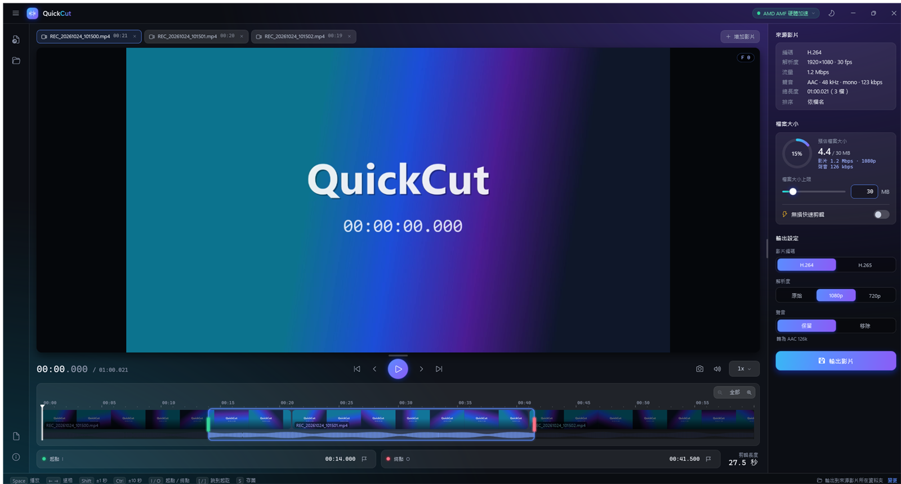

# QuickCut

快速、好上手的影片剪輯工具：選好起訖點、指定檔案大小，一鍵輸出。C# WPF（.NET Framework 4.8，Win10/11 內建），呼叫 FFmpeg 剪輯與編碼。

產品首頁：<https://coolalec.github.io/QuickCut/>



## 下載
到 [Releases](https://github.com/coolalec/QuickCut/releases/latest) 下載 `QuickCut-<版本>-win64.zip`，解壓後執行 `QuickCut\QuickCut.exe` 即可，不需安裝。

- 需求：Windows 10（1903 以後）或 Windows 11，64 位元。
- 程式沒有數位簽章，第一次執行時 Windows SmartScreen 可能跳出「Windows 已保護您的電腦」，按「其他資訊」→「仍要執行」。
- 請解壓到可寫入的資料夾（例如桌面或 D:\Tools），設定才存得下來。
- 驗證下載檔（選用）：每個 zip 都有 GitHub 簽發的建置來源證明，可用 [GitHub CLI](https://cli.github.com/) 確認它確實由本專案的 GitHub Actions 建置：
  ```powershell
  gh attestation verify QuickCut-<版本>-win64.zip --repo coolalec/QuickCut
  ```

## 功能
- 拖放或開啟一個或多個連續分段檔，依檔名接成一條時間軸（可拖曳上方分頁調整順序），可跨檔剪輯；「增加影片」可再加入檔案而不影響已選範圍
- FFmpeg 解碼預覽（可播 H.265，不需另裝解碼器）、有聲預覽（WinMM，聲音為同步主時鐘，變速保持音調）、逐格、¼～2 倍速；點畫面即可播放／暫停
- 目前畫面存成 PNG（原始解析度）
- 淺色／深色／依系統設定三種佈景
- 可拖曳調整設定欄寬度與預覽／時間軸高度，位置會記住
- 自動偵測顯示卡並實際試編，優先 NVIDIA NVENC → AMD AMF → Intel QSV → CPU
- 依「檔案大小上限 ÷ 剪輯長度」自動算流量；硬體編碼超出上限時自動降流量重編一次
- 手機直拍影片（旋轉標記）維持原始比例；1080p / 720p 指短邊，直式 1080p = 1080×1920；直橫混合合併時補黑邊
- 在時間軸按右鍵可把較近的起點或終點直接移過去
- 輸出 H.264 / H.265、原始 / 1080p / 720p、保留或移除聲音
  （AAC/MP3 直接複製；PCM 等轉 AAC 128k）
- 無損快速剪輯（不重新編碼、不限大小、原始解析度，起點對齊關鍵影格並顯示實際起點）

## 快捷鍵
| 鍵 | 功能 |
|---|---|
| Space／點畫面 | 播放／暫停 |
| ← / → | 上一格／下一格 |
| Shift + ← / → | ±1 秒 |
| Ctrl + ← / → | ±10 秒 |
| I / O | 以目前畫面設起點／終點 |
| [ / ] | 跳到起點／終點 |
| S | 目前畫面存成圖片 |
| M | 預覽聲音開／關 |
| + / - / \ | 放大／縮小時間軸／顯示全部 |
| 時間軸按右鍵 | 把較近的起點或終點移到該處 |
| Ctrl+O / Ctrl+S | 開啟影片／輸出 |

## 建置與發佈
需要 .NET SDK（8 以上）。
```powershell
cd QuickCut
powershell -ExecutionPolicy Bypass -File get-ffmpeg.ps1   # 下載 ffmpeg.json 指定版本的 FFmpeg shared build 到 ..\ffmpeg-<版本>-full_build-shared
dotnet build -c Debug                                     # 開發：自動找上層的 ffmpeg-*\bin
powershell -ExecutionPolicy Bypass -File publish.ps1 [-Zip] [-Version 1.2.0] [-FfmpegBin <ffmpeg\bin 資料夾>]
```
`publish.ps1` 會產生 `..\dist\QuickCut\`：`QuickCut.exe` ＋ `ffmpeg\bin\`（FFmpeg 的 ffmpeg / ffprobe 與 DLL），重新發佈時保留既有的設定檔；加 `-Zip` 另外產生可直接解壓使用的 zip。

### 版本號與發佈
版本號由 git tag 決定：在正式版 tag `v1.2.0` 上 build 是 `1.2.0`，之後第 3 個 commit 是 `1.2.0.3`（還沒有正式版之前是 `0.0.0.N`）。

- **Pre-release：** 每次 push 到 main，CI 會自動發出 pre-release `v1.2.0.3`，附上 zip，只保留最新 5 個。
- **正式版：** 測過某個 pre-release 沒問題後，到 Actions → **promote** → Run workflow，填入該 pre-release（例如 `v1.2.0.3`）和正式版號（例如 `1.3.0`）。它會在同一個 commit 打 `v1.3.0` tag 並重新建置成正式 Release。也可以直接在要發佈的 commit 上打 tag：
  ```powershell
  git tag v1.3.0
  git push origin v1.3.0
  ```
- 程式內的「檢查更新」只看正式版，不會通知 pre-release。

### CI（GitHub Actions）
- `build.yml`：push 到 main 時建置並發 pre-release；推 `vX.Y.Z` tag 或由 promote 呼叫時發正式 Release。每次建置也會留下 30 天的 artifact。
- `promote.yml`：把指定的 pre-release 轉成正式版（見上方）。
- `update-ffmpeg.yml`：每週檢查 gyan.dev 是否出了新的 FFmpeg 正式版（只看 `9.0.2` 這種純數字版本），有的話更新 `QuickCut/ffmpeg.json` 並發一個 pre-release；確認沒問題後再用 promote 發正式版。

設定存在執行檔旁的 `QuickCut.settings.xml`（程式資料夾需可寫入，否則設定不會保存，狀態列會提示）。

## 偵錯
Debug 版設定環境變數 `DC_SNAPSHOT=<資料夾>` 會每 2 秒把視窗畫面存成 PNG（不需螢幕擷取）。

## 回報問題與修改
本專案不接受 Issue 與 Pull request。需要修改的話歡迎 fork 後自行調整。

## 授權
QuickCut 以 [MIT](LICENSE) 授權。附帶的 FFmpeg 為 gyan.dev 的 shared build，以 GPLv3 授權，詳見 [THIRD-PARTY-NOTICES.txt](THIRD-PARTY-NOTICES.txt)。
